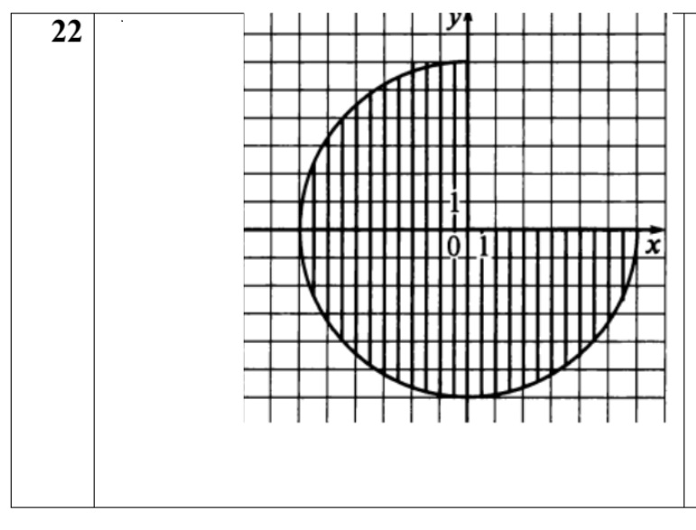
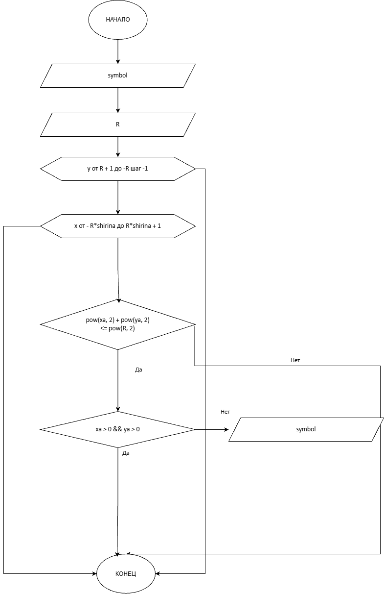

# Домашнее задание к работе 9
## Условие задачи
Написать программу, выводящую на экран заданную в ДЗ лаб.6 геометрическую фигуру, нарисованную с помощью заданного с клавиатуры символа.

Предусмотреть возможность изменения размеров фигуры путем задания ее размеров в количестве символов пользователем.
## 1.Алгоритм
1. **НАЧАЛО**
2. получение symbol
3. получение R
4. использвание вложенных циклов для создания плоскости и отрисовки в ней фигуры
### Блок-схема

## 2.Реализация программы
#include <stdio.h>
#include <math.h>
#include <locale.h>

main()
{
	setlocale(LC_CTYPE, "RUS");
	int shirina = 2;
	char input;
	printf("Введите символ, которым будет нарисована фигура\n");
	scanf("%c", &input);
	char symbol = input;
	int R;
	printf("Введите радиус окружности\n");
	scanf("%d", &R);
	for (int y = R + 1; y >= -R; y--)
	{
		for (int x = - R*shirina; x <= R*shirina + 1; x++)
		{
			double xa = (double)x/shirina;
			double ya = (double)y;
			if (pow(xa, 2) + pow(ya, 2) <= pow(R, 2)) {
				if (xa > 0 && ya > 0) {
					printf(" ");
				}
				else printf("%c", symbol);

			}
			else printf(" ");
		}
		printf("\n");
	}
}
## 3.Результат выполнения программы
Введите символ, которым будет нарисована фигура
x
Введите радиус окружности
6

            x
      xxxxxxx
    xxxxxxxxx
  xxxxxxxxxxx
 xxxxxxxxxxxx
 xxxxxxxxxxxx
xxxxxxxxxxxxxxxxxxxxxxxxx
 xxxxxxxxxxxxxxxxxxxxxxx
 xxxxxxxxxxxxxxxxxxxxxxx
  xxxxxxxxxxxxxxxxxxxxx
    xxxxxxxxxxxxxxxxx
      xxxxxxxxxxxxx
            x

C:\Users\tihon\source\repos\dzlab9\x64\Debug\dzlab9.exe (процесс 15764) завершил работу с кодом 0 (0x0).
Чтобы автоматически закрывать консоль при остановке отладки, включите параметр "Сервис" ->"Параметры" ->"Отладка" -> "Автоматически закрыть консоль при остановке отладки".
Нажмите любую клавишу, чтобы закрыть это окно:
## 4.Информация об авторе
Савченко Тихон бИЦТ-261

